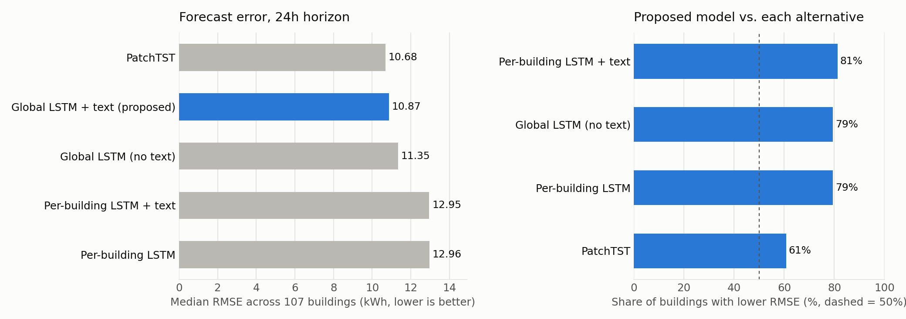
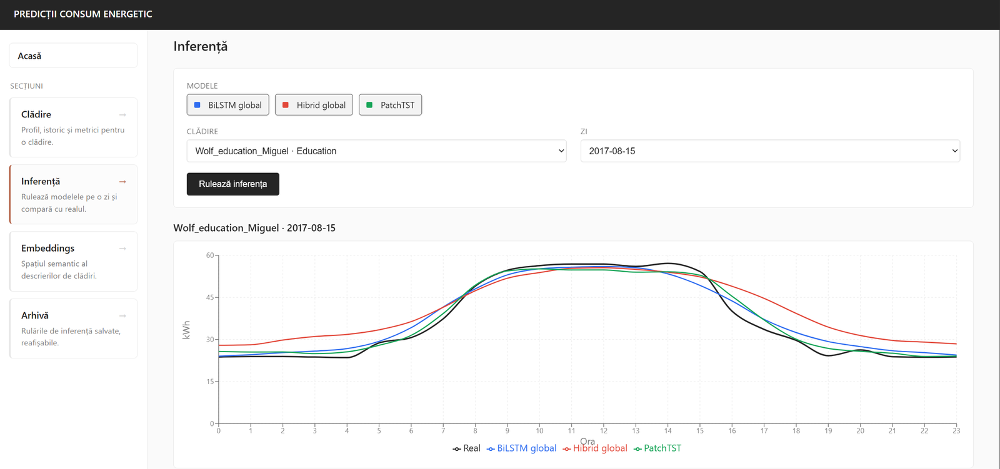
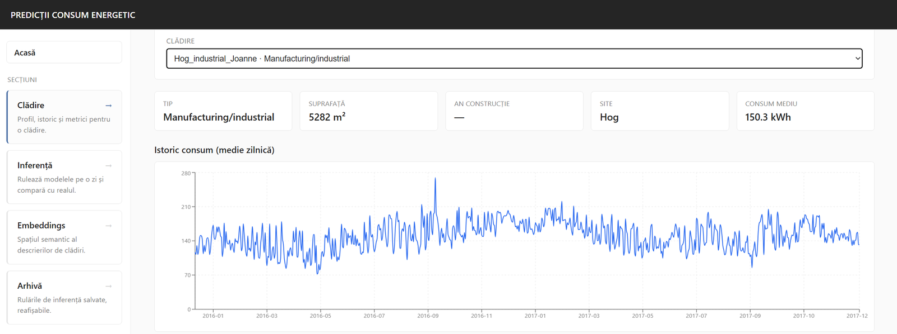
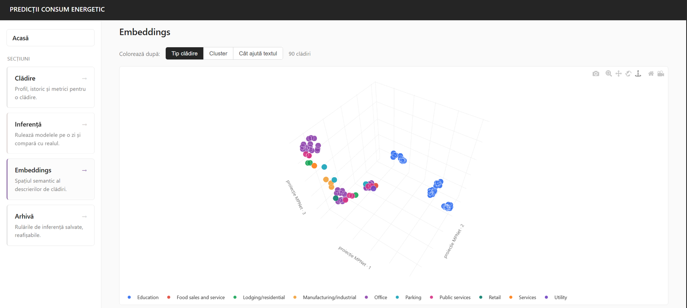

# Text-conditioned energy forecasting for buildings

Bachelor's thesis project: day-ahead (24h) electricity consumption forecasting for commercial buildings, using a **global BiLSTM conditioned on natural-language descriptions** of each building and of its recent context. The project includes a full-stack demo platform (FastAPI + PostgreSQL + React) for exploring predictions and running live inference.



## Idea

Per-building forecasting models ignore what is known *about* a building (type, size, age, climate, which meters it has) and about the days ahead (holidays, academic calendar, weather forecast). Pooling all buildings into one model usually causes negative transfer, because the buildings behave very differently.

This project turns that context into text, embeds it with a sentence transformer (`all-mpnet-base-v2`), and uses the embeddings to condition a single global model:

- **Static text** (one per building): type, floor area, age, climate zone, heating type, available meters. It modulates the LSTM representation through **FiLM** (γ, β), so the model knows *which* building it is forecasting.
- **Dynamic text** (one per forecast window): season, day type, holidays, academic calendar, 24h weather forecast, and consumption-profile statistics of the 168h lookback. It acts as the **query in an attention layer over the LSTM hidden states** and produces a zero-initialised correction (offset) of the forecast.
- An auxiliary **building-type classifier** on the static embedding regularises the text pathway.

Splitting the text into static and dynamic parts was a key finding: a single mean-pooled embedding of the whole text was dominated by static content, while the dynamic part on its own varied about 4× more between windows.

## Results

Evaluated on **107 buildings** from the [Building Data Genome Project 2](https://github.com/buds-lab/building-data-genome-project-2) (hourly data, 2016-2017), chronological split 70 / 10 / 20, 168h lookback, 24h horizon.

| Model | Median RMSE (kWh) | Median MAE | Median R² | Median WAPE |
|---|---|---|---|---|
| Per-building BiLSTM | 12.96 | 8.89 | 0.770 | 0.134 |
| Per-building BiLSTM + text | 12.95 | 8.58 | 0.761 | 0.137 |
| Global BiLSTM (no text) | 11.35 | 7.95 | 0.823 | 0.111 |
| PatchTST | **10.68** | **7.60** | 0.828 | 0.114 |
| **Global BiLSTM + text (proposed)** | 10.87 | 7.65 | **0.843** | **0.106** |

- The proposed model has lower RMSE than the text-free global model on **85 / 107** buildings, so the gain comes from the text conditioning, not only from pooling.
- It beats the per-building baseline on **85 / 107** buildings.
- Compared with **PatchTST**, a strong transformer baseline, it wins on 65 / 107 buildings and has better median R² and WAPE. PatchTST has a slightly lower median RMSE.

## Repository structure

```
Notebook-licenta.ipynb     Full pipeline: data, features, models, training, evaluation, export
sota_baselines.py          PatchTST implementation (baseline)
quality_audit.py           Data quality audit and building selection
select_buildings.py        Extends the building set using quality filters
demo/
  notebook_export.py       Exports predictions, embeddings and inference bundles from the notebook
  models.py                Model classes used for live inference
  backend/                 FastAPI app: buildings, predictions, metrics, live inference, run archive
  db/                      SQLAlchemy schema + init/seed scripts (PostgreSQL)
  scripts/                 Consolidates predictions into parquet files
  frontend/                React + Vite app (Recharts, Plotly)
```

### Notebook outline

1. Configuration and the list of target buildings
2. Feature engineering: 15 features (energy, calendar encodings, moving averages, weather), contiguous windowing
3. Data loading and scaling (scalers fit on the training split only)
4. `GlobalTextConditionedModel`: BiLSTM + FiLM (static text) + text-guided attention (dynamic text)
5. Text generation (static and dynamic templates) and MPNet embeddings with an on-disk cache
6. Training: per-building baselines, the global model, a no-text ablation, PatchTST
7. Evaluation (RMSE, MAE, R², WAPE), UMAP view of the embeddings, export to the demo platform

## Demo platform

A web app for exploring the results (UI in Romanian):

- **Building**: metadata, consumption history, daily/monthly/hourly profiles, test-set predictions of all 5 models with zoom, per-building metrics and the gain from text.
- **Inference**: pick a building, a test day and the models, then run a live forward pass on the server. The text contribution is shown separately.
- **Embeddings**: 3D map of the static building embeddings, coloured by building type, cluster or how much the text helps.
- **Archive**: inference runs stored in PostgreSQL.

**Live inference** for one test day (black = actual consumption):



**Building page** with metadata and consumption history:



**Embedding space** of the building descriptions:



Setup instructions are in [demo/README.md](demo/README.md) (in Romanian).

## Running it

```bash
python -m venv .venv
.venv\Scripts\activate            # Windows
pip install -r requirements.txt    # notebook
pip install -r demo/requirements.txt
```

1. Download BDG2 (`electricity.csv`, `electricity_cleaned.csv`, `metadata.csv`, `weather.csv` and the other meter files) into `data_set_genome/`.
2. Run `Notebook-licenta.ipynb` top to bottom. A CUDA GPU is recommended. Training writes the checkpoints (`*.pt`) and the export cells write `demo/data/`.
3. Start the demo as described in [demo/README.md](demo/README.md).

The dataset, trained checkpoints and generated data are not included in this repository.

## Tech stack

PyTorch, Hugging Face Transformers (sentence embeddings), scikit-learn, pandas, UMAP · FastAPI, SQLAlchemy, PostgreSQL · React, Vite, Recharts, Plotly
